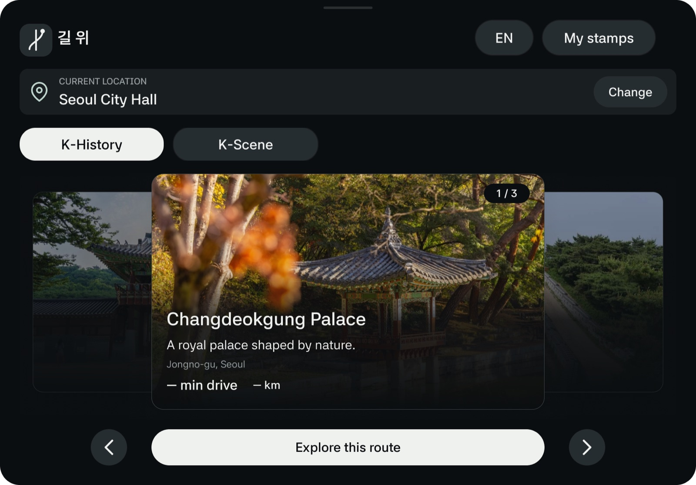
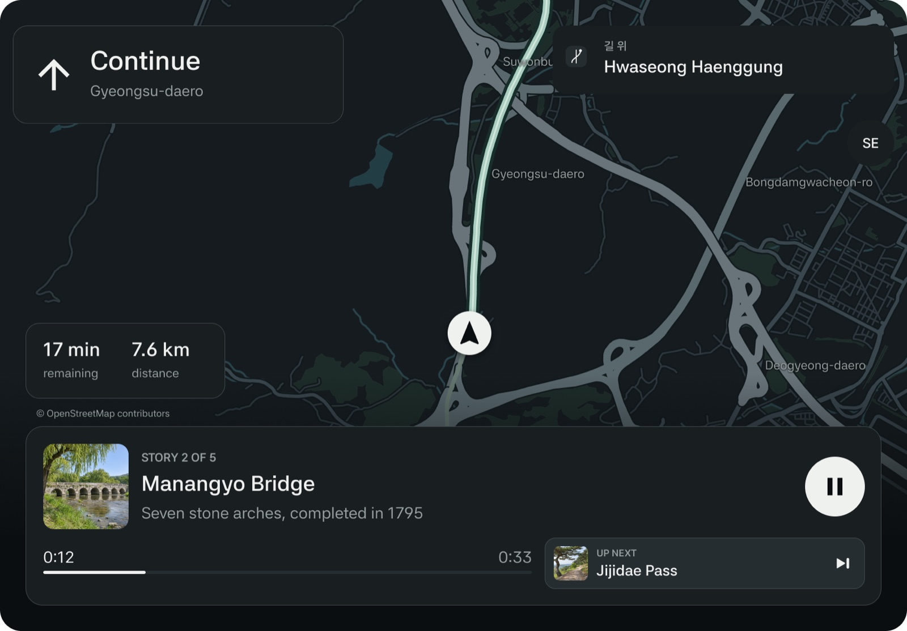
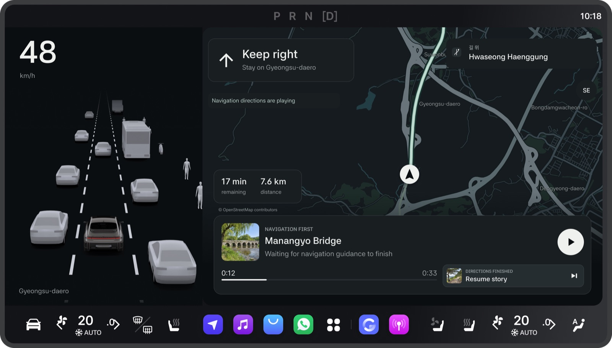
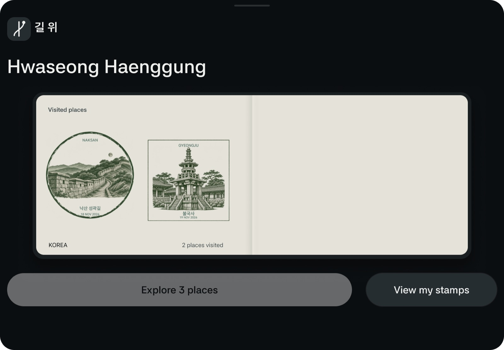
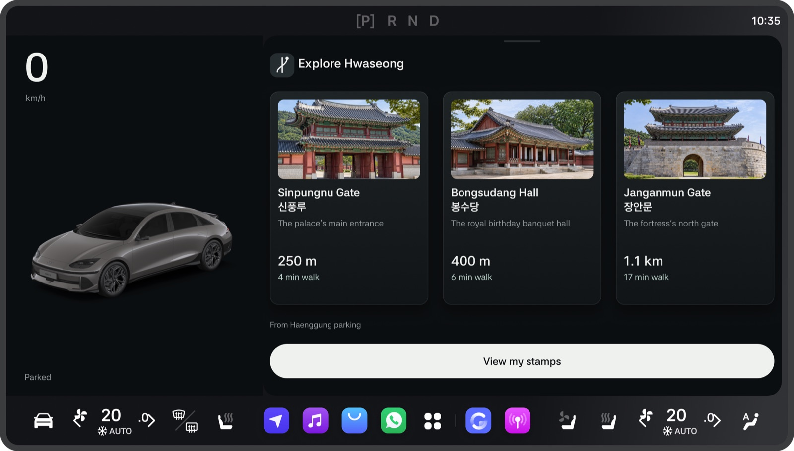
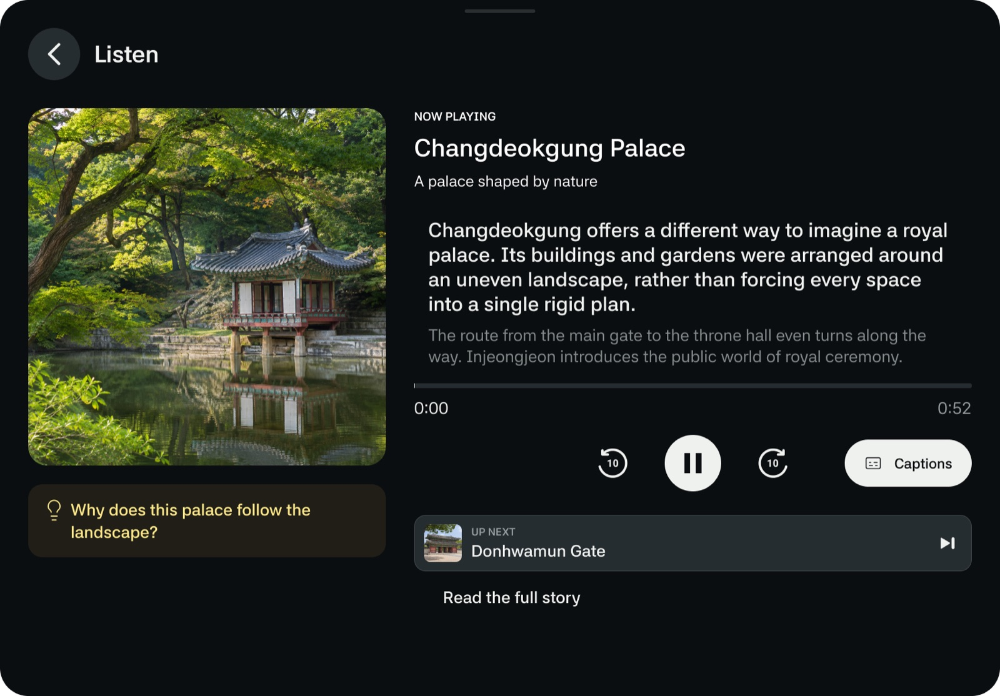

# 길 위 (Gil We)

차로 여행하는 방한 외국인에게 지나가는 길의 역사·문화를 모국어 오디오로 들려주고, 주차 후 스탬프로 여정을 남겨 주는 Pleos Connect 로드트립 앱.


---

## 핵심 기능

### 1. 출발 전 · 언어와 코스 선택
화면 언어와 해설 언어를 따로 고르고(영어·한국어·일본어·중국어·베트남어·태국어), 역사 중심 **K-History**와 촬영지 중심 **K-Scene** 가운데 코스를 고릅니다. 코스를 고르면 기본 내비에 도착 주차장이 목적지로 설정되고 안내가 시작됩니다.



### 2. 주행 중 · 위치 기반으로 이어지는 이야기
장소 이야기마다 좌표·반경·중요도를 두고, 차량 GPS·내비 위치로 다음 장소까지 남은 시간을 계속 다시 계산해 **그 자리에 닿을 때** 이야기를 재생합니다. 장소 사이 빈 시간은 배경·인물 이야기로 채우고, 출발 때는 코스 소개, 도착 2km 앞에서는 '꼭 볼 세 곳'을 들려줍니다. 내비 화면이 앞에 있을 때는 그 위에 이야기 카드를 띄웁니다.



### 3. 길 안내 우선 · 운전자는 듣기만
내비 음성이 나오면 이야기를 멈추고 '내비 안내 우선'을 표시한 뒤, 안내가 끝나면 멈춘 문장 처음부터 이어서 재생합니다. 위치 신호가 끊기면 마지막 속도·방향으로 위치를 추정해 계속 진행합니다. 주행 중에는 소형 플레이어만 두고, 이야기 전문·사진·스탬프는 주차 후에만 열립니다.



### 4. 도착 · 주차하면 스탬프
내비 도착 이벤트와 P단이 함께 확인되면 여권 모양의 기록에 스탬프가 찍힙니다(기어 신호가 없는 차량은 '주차했어요'로 확인). 이어서 주차장에서 걸어서 갈 수 있는 세 곳을 거리·도보 시간과 함께 안내합니다.

| 스탬프 수집 | 주변 장소 둘러보기 |
|---|---|
|  |  |

### 5. 주차 후 · 다시 듣기와 전문
지나온 길의 이야기를 문장 자막과 함께 다시 듣고, 출처가 달린 전문을 읽습니다. My stamps에서는 저장 시각으로 묶은 '이번 여행 / 지난 여행'을 나눠 봅니다.



---

## 실행 방법

### 요구 사항
- Android Studio (JDK 17, Android Studio 내장 JBR 사용 가능)
- Pleos Connect Emulator (Android Automotive, API 34) AVD — [설치 가이드](https://document.pleos.ai/en/docs/connect/guide/getting-started/application-development/setup-connect-sdk-emulator)
- Pleos SDK는 `settings.gradle.kts`에 등록된 Pleos Maven 저장소에서 자동으로 받습니다. 별도 키는 필요 없습니다.

### 빌드·설치
```bash
# Android Studio 의 JBR 을 쓰는 경우
export JAVA_HOME="/Applications/Android Studio.app/Contents/jbr/Contents/Home"

./gradlew installDebug        # 실행 중인 에뮬레이터에 설치
./gradlew assembleRelease     # 제출용 APK 빌드
```
또는 Android Studio에서 프로젝트를 열고 Pleos Connect AVD를 선택해 Run 합니다.

### 처음 실행할 때 권한
앱이 알림·위치 권한을 요청합니다. 아래 두 권한은 차량 설정 화면이 없는 에뮬레이터에서 adb로 허용합니다.
```bash
adb shell appops set pleos.gilwe SYSTEM_ALERT_WINDOW allow   # 내비 위 이야기 카드
adb shell appops set pleos.gilwe GET_USAGE_STATS allow       # 내비가 앞에 있을 때만 카드 표시
```
허용하지 않아도 앱은 동작하며, 내비 위 카드 대신 헤드업 알림으로 현재 이야기를 보여 줍니다.

---

## 테스트 환경·설정

| 항목 | 내용 |
|---|---|
| 플랫폼 | Pleos Connect (Android Automotive OS), minSdk 28 / targetSdk 34 |
| 언어·UI | Kotlin, Jetpack Compose |
| SDK | Pleos Vehicle SDK 2.3.2 (기어), NaviHelper SDK 3.0.5 (내비), TextToSpeech SDK 3.3.1 (음성 합성) |
| 검증 환경 | Pleos Connect Emulator v2.1.0 (API 34), macOS |
| 화면 언어 | 6개 언어 선택, 화면 문구·녹음 음성은 한국어·영어 (그 밖의 언어는 TTS 낭독) |
| 콘텐츠 | 5개 코스, 이야기 19편 + 코스 소개 5편 + 마무리 안내 5편 |

### 에뮬레이터에서 주행 시연하기
1. 앱에서 **K-History → 화성행궁 → 소개 듣기**를 누르면 기본 내비 안내와 코스 소개가 시작됩니다.
2. 다른 터미널에서 GPS 경로를 재생하면 차가 서울시청에서 화성행궁까지 달리는 것처럼 위치가 바뀌고, 장소마다 이야기가 이어집니다.
```bash
python3 tools/gps_route.py hwaseong 180     # 코스, 속도(km/h)
```
- 기어(P/D)는 홈 화면 왼쪽 위 길 위 로고(주행 화면에서는 목적지 칩)를 눌러 여는 시연 도구에서 바꿀 수 있습니다.
- 에뮬레이터의 기본 내비 앱은 재생된 GPS를 지도에 반영하지 않습니다. 이야기 재생은 차량 GPS로 판단하므로 시연에는 영향이 없습니다.

### 음성 파일 다시 만들기
이야기 원고(`data/Courses.kt`)를 고치면 문장 단위 음성 파일을 다시 생성합니다(macOS `say`, Yuna·Samantha 음성).
```bash
python3 tools/make_voice.py
```

---

## APK 위치

| 파일 | 설명 |
|---|---|
| [`release/gilwe-v1.0.apk`](release/gilwe-v1.0.apk) | 제출용 APK (versionName 1.0, debug 키 서명) |
| `app/build/outputs/apk/release/app-release.apk` | `./gradlew assembleRelease` 빌드 결과 |

```bash
adb install -r release/gilwe-v1.0.apk
```

---

## 참고
- 프로토타입의 이야기와 음성은 생성형 AI로 제작했으며, 서비스 단계에서는 공공 관광 데이터를 원천으로 문화관광해설사·학예사 감수와 원어민 검수를 거쳐 교체할 계획입니다.
- 코스 사진은 한국관광공사 자료를 사용했습니다.
